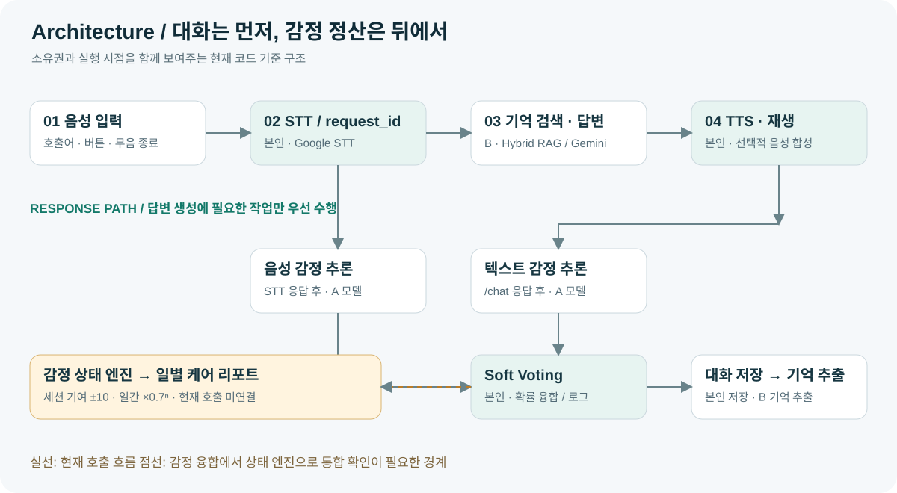
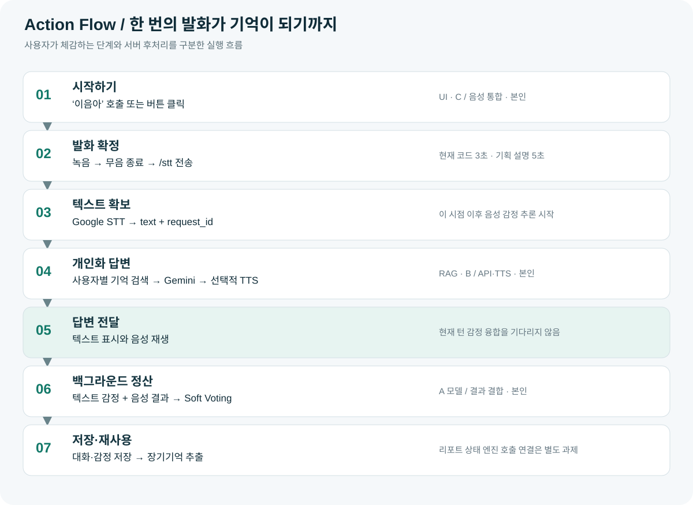
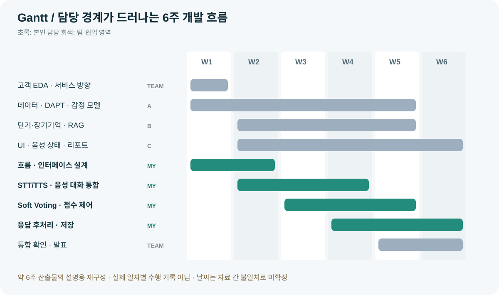

# Maum — 시니어 정서 케어 AI 말벗

고객 EDA에서 고령 이용자 특성에 주목해 기획한 음성 대화·기억 기반 개인화·정서 리포트 프로토타입입니다. TV·셋톱박스를 돌봄 접점으로 확장하고, 말벗 이용을 통한 재방문과 이용시간 확대를 가설로 삼았습니다. 실제 기기 배포·이용시간 증가·돌봄 효과를 검증한 상용 서비스는 아닙니다.

> **공개 준비 중:** 이전 커밋의 환경변수 예시에 DB 자격증명이 포함돼 있었습니다. 현재 예시는 치환했고 15개 원격 브랜치 이력을 정리했습니다. 기존 clone·캐시에 잔존할 수 있으므로 비밀번호 교체를 확인하기 전에는 저장소를 public으로 전환하지 마세요. [공개 범위 및 점검 결과](docs/PUBLIC_RELEASE.md)

## 핵심 구현

- 호출어 “이음아” 또는 UI 버튼으로 녹음 시작, 무음 감지 후 STT 전송.
- Google STT → 사용자별 Hybrid RAG/Gemini → 선택적 TTS로 음성 대화 연결.
- request_id로 발화별 비동기 음성·텍스트 감정 결과 결합.
- 응답 후 Soft Voting, 대화·감정 저장, 장기기억 추출 실행.
- 세션 기여 제한과 일간 감쇠를 갖춘 감정 상태 엔진.
- 주간 정서 추이, 최근 14일 마음 날씨, 월간 키워드, 회상 메시지 API.

## 역할

| 담당 | 기여 |
| --- | --- |
| 본인 · AI Backend | 흐름 설계, STT/TTS 연동, request_id, 응답 후처리, Soft Voting, 감정 점수 관리 |
| A · 감정 모델 | 음성·텍스트 데이터 DAPT 및 LoRA fine-tuning |
| B · 기억·RAG | 단기·장기기억, Hybrid Search, Gemini 공감 답변 |
| C · UI | 사용자 화면과 UI 구현 |

학습·RAG 내부 구현과 백엔드 통합 책임을 구분합니다. 사용 데이터의 정확한 건수와 최종 모델 성능은 이 저장소에서 재검증하지 않았습니다.

## Architecture



STT가 완료된 뒤 음성 감정 추론을 시작합니다. 이후 RAG 응답 생성과 음성 감정 처리는 겹쳐 진행될 수 있습니다. 텍스트 감정 분석·융합·저장은 /chat 응답 후 수행합니다.

## Action Flow



1. UI에서 녹음 후 POST /stt 호출.
2. 반환된 text와 request_id로 POST /chat 호출.
3. 사용자별 장기기억 검색과 답변 생성, 요청에 따라 TTS 포함.
4. 사용자에게 답변을 전달한 뒤 감정 결과 결합·대화 저장.
5. 저장된 대화에서 장기기억 추출.

## 구현 범위와 한계

| 항목 | 현재 코드 |
| --- | --- |
| 음성 입력 | 브라우저 프로토타입. 현재 무음 3초, 프론트 음성 세션 5분 |
| 감정 모델 | HuBERT-LoRA 음성 / KcELECTRA-LoRA 텍스트 로더 |
| 감정 정산 | 10분 공백 또는 날짜 변경, 세션 기여 -10~+10 |
| 누적 점수 | -30~100, 경과 일수 n에 대해 기존 누적값 ×0.7ⁿ |
| 일간 감쇠 시점 | 상태 갱신 함수 호출 시 날짜 차이를 반영. 자정 배치 실행 아님 |
| 통합 경계 | 최신 음성 후처리는 update_user_emotion()을 직접 호출하지 않음 |
| 후처리 신뢰성 | BackgroundTasks·인메모리 캐시. 내구성 있는 큐·공유 캐시 아님 |
| 평가 | 응답 p95, 정확도 개선, 실제 케어 효과는 검증 결과 없음 |

감정 융합의 확률 점수와 누적 distress 점수는 다른 지표입니다. 감쇠 계수의 논문 근거와 임상 유효성을 확정하지 않았으며 의료 진단 지표가 아닙니다. API의 user_id 필터링은 인증·인가를 대신하지 않습니다.

## 실행

### 전제

- Python 3.11 권장: 프로젝트 재현 기준으로 제시하며 잠금 파일 기반 검증 환경은 아닙니다.
- GCP 프로젝트, STT·TTS 및 사용 중인 Gemini/임베딩 API 권한과 결제 설정.
- Google Application Default Credentials 또는 별도 서비스 계정 파일.
- 별도 Supabase 프로젝트와 기존 테이블·RPC. **완전한 SQL 마이그레이션이 포함되지 않아 clone만으로 DB가 구축되지 않습니다.**
- 음성 감정 분석에는 모델 체크포인트와 ffmpeg가 추가로 필요합니다.

### Windows PowerShell

저장소 루트에서 실행합니다.

```powershell
cd C:\Users\snnys\DX_Team4
python -m venv .venv
.\.venv\Scripts\Activate.ps1
python -m pip install -r requirements.txt
Copy-Item .env.example .env
```

.env에 본인의 프로젝트 값을 채웁니다. 예시값은 실행 가능한 계정이 아닙니다. 서비스 계정 파일은 저장소 밖에 두고 셸에도 경로를 지정합니다.

```powershell
$env:GOOGLE_APPLICATION_CREDENTIALS = "C:\secure\maum-service-account.json"
python -m uvicorn app.main:app --host 127.0.0.1 --port 7001 --reload
```

브라우저 UI: http://127.0.0.1:7001 · API 명세: http://127.0.0.1:7001/docs

```powershell
Invoke-RestMethod http://127.0.0.1:7001/health
```

/health는 프로세스 응답만 확인하며 DB·GCP·모델 정상 여부를 보장하지 않습니다. 응답은 브라우저와 HTTP JSON으로 전달되고, 대화·감정 후처리 결과는 Supabase에 저장됩니다. 기본 서버 로그는 터미널에 출력됩니다.

### 감정 모델 추론

하드웨어에 맞는 PyTorch를 선택한 뒤 다음 추가 의존성과 모델을 준비합니다. 체크포인트와 학습 원본은 배포하지 않습니다.

```powershell
python -m pip install -r requirements-models.txt
ffmpeg -version
```

| 파일 | 역할 |
| --- | --- |
| models/audio/best_hubert_lora.pt | 음성 감정 체크포인트 |
| models/text/best_kcelectra_lora.pt | 텍스트 체크포인트. 대안: models/text/best 또는 last의 HF/PEFT 디렉터리 |
| models/soft_voting.csv | w_text_star, w_audio_star, neutral_margin_star 열 필요 |

현재 추론 로더는 위 경로를 직접 참조합니다. app/config.py의 체크포인트 경로 설정만 바꿔서 경로가 전환된다고 가정하면 안 됩니다. HF QLoRA 어댑터는 환경에 맞는 bitsandbytes가 추가로 필요할 수 있습니다.

## 주요 API

| 경로 | 목적 |
| --- | --- |
| POST /stt | 녹음 파일 → text, request_id |
| POST /chat | 개인화 답변, include_tts=true이면 MP3 base64 포함 |
| POST /tts | 텍스트 음성 합성 |
| POST /extract-memory | 단기 대화의 장기기억 추출 |
| GET /report-summary/{user_id} | 정서 추이·키워드·회상 데이터 |
| GET /reports/{user_id} | 일별 케어 리포트 |
| GET /health | 프로세스 응답 확인 |

DB가 준비된 로컬 환경에서 텍스트 대화를 호출하는 예시입니다. 비용이 발생할 수 있습니다.

```powershell
$body = @{ user_id = "demo-user"; message = "오늘 산책을 다녀왔어요"; include_tts = $false } | ConvertTo-Json
Invoke-RestMethod -Uri http://127.0.0.1:7001/chat -Method Post -ContentType "application/json; charset=utf-8" -Body ([System.Text.Encoding]::UTF8.GetBytes($body))
```

request_id 없는 호출은 감정 분석 없이 대화만 저장하는 경로입니다. 실제 사용자 개인정보 대신 합성 데모 데이터를 사용하세요.

## 개발 흐름



기존 약 6주 산출물의 설명용 재구성으로 실제 일자별 수행 증빙은 아닙니다. 문서의 기간 표현이 달라 절대 날짜는 확정하지 않았습니다.

## 저장소 구성

```text
app/                    FastAPI, STT/TTS, RAG, 감정 상태·리포트
src/                    모델 로더와 전처리 모듈
static/                 실제 서비스 UI와 정적 자산
scripts/                데이터 보정·시드·공개 전 점검
docs/images/            공개용 아키텍처·액션·일정 SVG
docs/PUBLIC_RELEASE.md  공개 범위, 노출 점검, 남은 조치
.env.example            비밀값 없는 설정 예시
```

포트폴리오 HTML과 내부 생성 초안은 공개 대상에서 제외합니다. static/은 서비스 구현이므로 별개로 유지합니다. 정적 이미지·폰트·음원의 재배포 권리는 공개 전 확인해야 합니다. 별도 오픈소스 라이선스를 임의로 부여하지 않았습니다.

## 공개 전 검사

```powershell
python scripts/check_public_release.py
python scripts/check_public_release.py --history
```

검사는 값 대신 경로·종류·Git 객체 ID만 출력합니다. 첫 명령은 추적 파일의 현재 작업 사본, 두 번째는 추가로 로컬에 알려진 전체 refs의 과거 blob을 검사합니다. 완전한 비밀정보 탐지나 개인정보·저작권 검토를 대신하지 않습니다.
